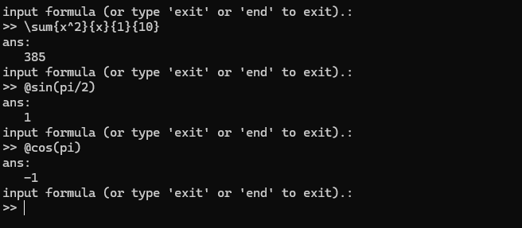
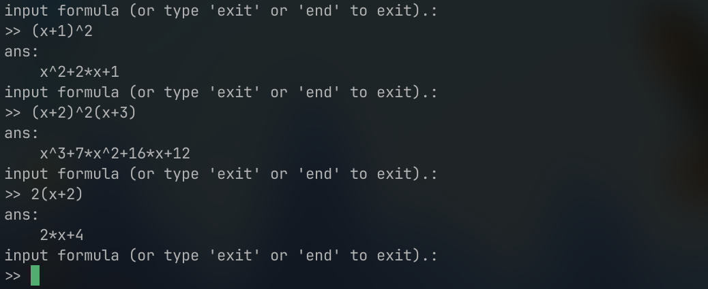

# SciCalc

~~簡易的な~~数式処理エンジン

- std::string型の文字列を数式として解釈し、計算する
- ~~C++標準ライブラリのみ使用~~
    - 多項式関係の処理が大きくなったので Polynomial として分離
- 変数を利用可能
    - 変数への代入
    - 変数を用いた数値計算
    - 積分変数の任意指定　など
- 初等関数に対応
- 総和、総乗、数値微積分などの計算に対応
- 多項式の展開に対応

# DEMO



コンソール関数電卓としての利用例。
`std::string`型の数式を計算し、答えを`double`型で返す。



多項式の展開。
`std::string`型の数式を評価し、展開後の式を`std::string`型で返す。

# Installation

### MSVCの場合
```
mkdir build
cd build
cmake ..
cmake --build . --config Release
cmake --install .
```

### GNUCの場合
```
mkdir build
cd build
cmake ..
cmake --build .
cmake --install .
```

### Androidの場合
ABIごとにビルドディレクトリ・インストール先を分けることを推奨します。

ここでは

- ABI：x86
- Buildディレクトリ：./build_x86
- Install先：/usr/local/android/x86
- NDKのパス：~/Android/Sdk/ndk/25.0.0/
- android-24 を使用

として進めますが、ご自身の環境に合わせてください。
```
mkdir build_x86
cd build_x86
cmake .. -G Ninja -DCMAKE_TOOLCHAIN_FILE=~/Android/Sdk/ndk/25.0.0/build/cmake/android.toolchain.cmake -DANDROID_ABI=x86 -DANDROID_PLATFORM=android-24 -DCMAKE_PREFIX_PATH=/usr/local/android/x86
cmake --build .
cmake --install . --prefix /usr/local/android/x86
```

# Dependencies

- Polynomial

# Description

## Grammar

### Numbers

半角数字（`0`~`9`）から始まる文字列は数値として解釈されます。
整数はもちろん、実数にも対応しています。たとえば`2.34`は $2.34$ として解釈されます。

また、暗黙の乗算にも対応しています。
たとえば`2x(abc-2)`は $2\times x \times (abc-2)$ として解釈されます。

### Variables

SciCalcは、アルファベットから始まる、演算子や`@`、`\`を含まない任意の文字列を変数の名前として解釈します。
たとえば
```
a2b3c+4
```
のような式が入力された場合、`a2b3c`は変数名として解釈されます。
なお、特別なもの（`pi`、`e`など）を除く全ての変数の初期値は $0$ に設定されています。
したがって、上の例で`a2b3c`が初出だった場合、計算結果は4になります。

変数には任意の値を代入することができます。
また、お使いの端末のメモリに余裕がある限り、変数の個数に制限はありません。

以下の変数名についても任意の値を代入することは可能ですが、計算が完了すると上書きされてしまうため推奨しません。

- `ans`：1つ前の計算結果が格納されます。初期値は0です。
- `preans`：2つ前の計算結果が格納されます。初期値は0です。

また、`pi`や`e`などには初期値（それぞれ円周率とネイピア数）が設定されていますが、任意の値を代入して使用することも可能です。
たとえば
```
pi:=2
e:=3
```
を実行すると、`pi`の中身は $2$ 、`e`の中身は $3$ になります。

### Operators

以下の二項演算子に対応しています。

- `+`：加算
- `-`：減算
- `*`：乗算
- `/`：除算
- `^`：べき乗
- `:=`：代入（左向き）
    - 左辺に右辺を代入します
    - 左辺は必ず変数である必要があります
    - 他の演算子や関数と組み合わせられた場合、代入後の数値として扱われます
        - `(x:=3)+3`なら`x`の中身は $3$ になりますが、答えは $6$ になります
- `=:`：代入（右向き）
    - 右辺に左辺を代入します
    - 右辺は必ず変数である必要があります
    - 他の演算子や関数と組み合わせられた場合、代入後の数値として扱われます

### Mathematical Functions

数学関数は必ず`@`から始まります。
SciCalcでは任意のアルファベット文字列を変数として扱うため、変数と数学関数を区別するマーカーが必要になります。
そのマーカーの役割を`@`が果たしています。

数学関数名と同名の変数の使用を許可しない場合マーカーは不要ですが、
今後の拡張性と、表示と中身は別に出来る（電卓アプリの計算アルゴリズム用途であるため）という点から、このような仕様としました。

SciCalcでは、数学関数の直後にあるものを引数として解釈します。
たとえば
```
@sin2
```
の場合、 $\sin(2)$ として解釈されます。
```
@sin@cosx
```
は $\sin(\cos(x))$ として解釈されます。
なおSciCalcでは半角スペースは無視されるため、
```
@sin h
```
は単に $\sinh$ として解釈され、計算結果は $\sinh(0)$ となります。
これは、SciCalcが空文字列を $0$ として解釈するためです。
このため、 $\sin h$ のような式を計算したい場合は、`@sin(h)`のように引数を`()`で囲う必要があります。

現時点では、以下の数学関数に対応しています

- `@sin`：正弦関数
- `@cos`：余弦関数
- `@tan`：正接関数
- `@arcsin`：逆正弦関数
- `@arccos`：逆余弦関数
- `@arctan`：逆正接関数
- `@sinh`：双曲線正弦
- `@cosh`：双曲線余弦
- `@tanh`：双曲線正接
- `@arcsinh`：逆双曲線正弦
- `@arccosh`：逆双曲線余弦
- `@arctanh`：逆双曲線正接
- `@exp`：指数関数
- `@log`：常用対数
- `@ln`：自然対数
- `@gamma`：ガンマ関数
- `@sqrt`：平方根
- `@cbrt`：三乗根

### Special Functions

SciCalcでは、2つ以上の引数を取る要素は特殊関数と呼ばれます。
特殊関数は全て`\`から始まり、引数は`{}`で囲われます。
全ての特殊関数は以下の構文で表されます。
```
\name{arg1}{arg2}...
```
`\name`は特殊関数の名前、`arg1`は第1引数、`arg2`は第2引数を表します。
引数の個数は特殊関数の種類ごとに固定です。

以下の特殊関数に対応しています。

- `\sum{body}{var}{start}{end}`：総和
    - $\sum^{end}_{var = start}(body)$
    - `var`は変数である必要があります
- `\prod{body}{var}{start}{end}`：総乗
    - $\prod^{end}_{var = start}(body)$
    - `var`は変数である必要があります
- `\int{body}{var}{start}{end}`：定積分（台形積分）
    - $\int^{end}_{start}body \ \text{d}(var)$
    - `var`は変数である必要があります
- `\diff{body}{var}{x}`：数値微分（中心差分）
    - $\frac{\text{d}}{\text{d}(var)}(body) |_{var = x}$
    - `var`は変数である必要があります
- `\perm{n}{r}`：順列
    - ${}_n P_r$
- `\comb{n}{r}`：組み合わせ
    - ${}_n C_r$
- `\log{base}{body}`：対数
    - ${\log}_{base} (body)$

変数を使用する特殊関数（総和など）でカウント変数や積分変数として使われた変数の値は特殊関数の評価後に復元されます。
すなわち、特殊関数内での使用によって変数の値が書き換えられることはありません。
たとえば
```
x:=3
\sum{x^2}{x}{1}{10}
x
```
のような入力がされた場合、3行目の計算結果は $3$ になります。

ただし、特殊関数内でカウント変数や積分変数として指定していない変数については、値の復元は行われません。
たとえば
```
y:=10
\sum{y:=1}{x}{1}{10}
y
```
のような式が入力された場合、`y`は特殊関数の評価後に復元されないため、3行目の計算結果は $1$ になります。

数学関数（引数が1つの関数）を特殊関数に含めることは可能ですが、以下の理由により推奨されません。

- 毎回`{}`を入力するのは面倒
- `()`は何重になっていてもパース可能なので、ユーザが括弧を使いたければそちらを使えば良い
- 引数が1つならどこまでが引数なのかを明示的に示す必要がない
    - 演算子でパースした後、関数名の直後に続いているものを引数として解釈すればよい。

## Algorithm

### Node optimization

SciCalcでは、入力された数式から抽象構文木（AST）を生成し、ASTを再帰的に評価することで計算を行います。
ASTの評価を再帰的に行う理由は、特殊関数（とくに総和や総乗、数値積分）のネストを許容する仕様上、スタック命令列への変換が~~すごく面倒~~困難であったためです。

ただし再帰処理では、ASTが深いと評価関数の呼び出しのオーバーヘッドが問題となる可能性があります。
そこで、ASTの生成と同時に最適化を行うことでノード数を削減し、オーバーヘッドの問題を解消しています。

SciCalcが行う最適化処理は以下の通りです。

- Constant Folding (CF)
    - 定数式を事前に計算し、その計算結果を定数ノードとして保持する
    - `1+2`→`3`
    - `@sin1`→`0.84147...`
    - `\sum{2}{x}{1}{10}`→`20`　など
- Constant Propagation (CP)
    - 式中で値が変化しない変数を定数ノードに置き換える
- Algebraic Simplification (AS)
    - 代数的な式変形に基づいて、無駄なノードを削減する
    - +0、-0の削減（`x+0`→`x`、`x-0`→`x`）
    - ×1、÷1の削減（`x*1`→`x`、`x/1`→`x`）　など
- Combine Like Terms (CLT)
    - `A+A`→`2*A`
    - `A*A`→`A^2`

これらの使用/不使用はフラグによって管理されており、個別にON/OFFが可能です。
なお、標準で全ての最適化処理が有効になっています。
このため、多くの数式（代入演算子や特殊関数を用いない式）では、（CFおよびCPによって）最終的なノード数が1になります。
